# Análisis de PCAP: Host infectado con malware

En esta ocasión aprenderemos cómo analizar un archivo PCAP en Wireshark con filtros y técnicas básicas, así como su proceso de análisis. Se sospecha que la computadora de uno de los empleados, dentro de la red de la compañia, ha sido infectada con algún tipo de malware. Aparentemente este empleado cuyo visito una página web infectada. A primera vista se ven conexiones extrañas, las investigaremos a continuación.

  
  

---

Licencia

Copyright © 2026 Razezape. All Rights Reserved.

Este documento y su contenido se comparten con fines educativos. Queda prohibida su reproducción, distribución o modificación, total o parcial, sin autorización previa y por escrito del autor.

---

## Tarea 1: Identificar las características del host infectado

Primero, utilizamos **Suricata** para generar alertas mediante reglas de detección, offline/online, que pueden ser las incluidas por defecto o reglas adicionales que podemos descargar e incorporar. Aquí creamos primero una **carpeta**, donde se almacenarán nuestras alertas.

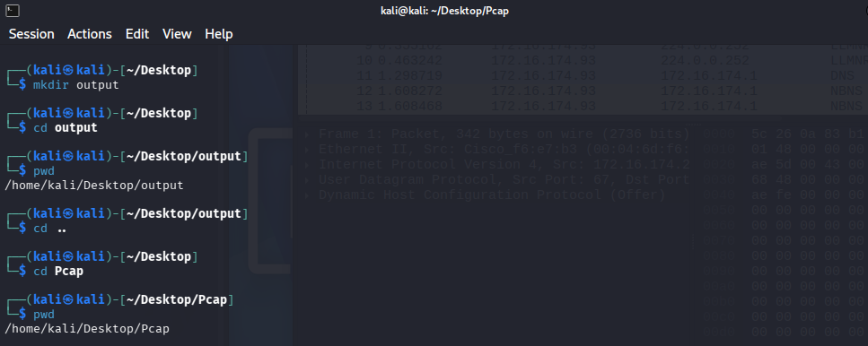

Seguidamente, corremos el comando con la ruta del archivo **suricata.yaml**, que contiene la configuración principal de interfaz de red y reglas de detección de Suricata, como el snort.conf en snort.

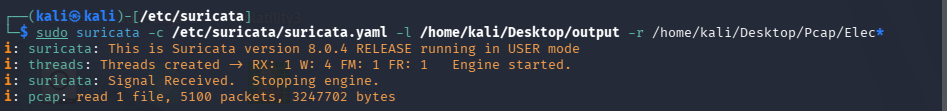

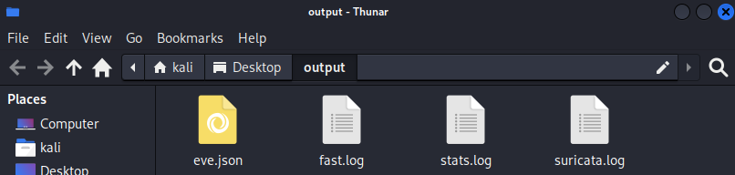

Veremos que se generaron varios archivos, pero nos enfocaremos en **fast.log.** Aquí las alertas de Suricata, están clasificadas en tres niveles de prioridad, donde priority 1 representa el nivel más alto de gravedad.

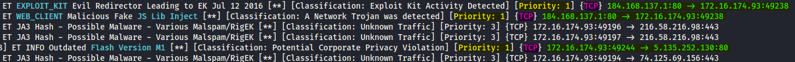

- **Priority 1:** La primera alerta indica que se detectó tráfico sospechoso proveniente de la IP 184.168.137.180, asociado al uso de un ***Exploit Kit (EK)***, dirigido al host potencialmente infectado 172.16.174.93. La comunicación se realizó a través del puerto 80 *(HTTP)* del origen y el puerto temporal 49238 del host infectado, utilizado para recibir el tráfico.

- **Priority 1:** La segunda alerta indica una posible inyección de una librería JavaScript maliciosa desde el mismo host externo hacia nuestro host interno, clasificada como un Network Trojan. Suricata detecta esta actividad maliciosa, inspeccionando el contenido HTTP y comparando patrones sospechosos con sus reglas de detección.

- **Priority 1:** La tercera alerta indica que Suricata detectó una versión desactualizada de Adobe Flash comunicándose desde nuestro host sospechoso hacia la IP externa. Esto representa un posible riesgo de seguridad, ya que las versiones antiguas de Flash pueden contener vulnerabilidades que los atacantes podrían explotar para ejecutar código malicioso.

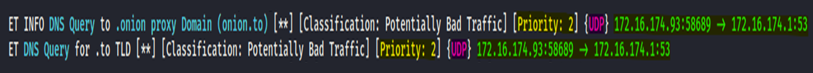

- **Priority 2:** Suricata detectó una consulta DNS saliente desde nuestro host sospechoso 172.16.174.93:58689 hacia el dominio onion.to, enviando la solicitud al gateway/router/switch 172.16.174.1:53 mediante UDP.

Recordemos que DNS se encarga de traducir nombres de dominio a direcciones IP y que UDP permite realizar estas consultas rápidamente sin necesidad de establecer previamente una conexión. En este caso, resulta interesante que el dominio consultado esté relacionado con un servicio proxy de Tor, lo que resulta especialmente sospechoso, ya que onion.to está relacionado con servicios proxy de Tor, una red que permite ocultar la identidad y el origen del tráfico. Esto podría sugerir que el equipo comprometido intentaba establecer comunicaciones de forma anónima, posiblemente para ocultar actividad maliciosa.

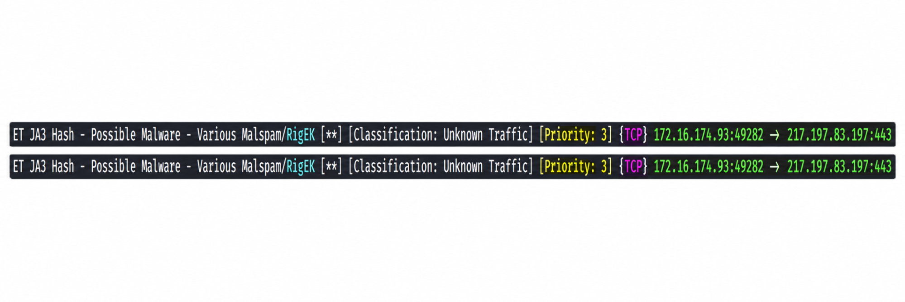

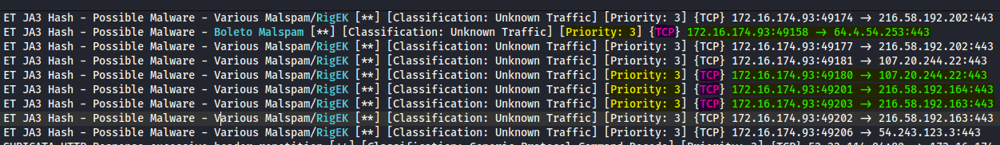

- **Priority 3:** La alerta hace referencia a un JA3 Hash, es decir, una huella digital *(fingerprint)* generada mediante el análisis de las características de una conexión TLS. Esta huella se obtiene mediante un hash MD5 y permite identificar y comparar patrones de conexión, de forma similar a cuando extraemos el hash de un archivo para compararlo con bases de datos de malware.

Es importante entender que **los fingerprints TLS** *(JA3)* permiten identificar cómo un cliente inicia una conexión TLS, mientras que los **TLS certificates** ayudan a verificar la identidad del servidor.

En este caso, los fingerprints JA3 detectados coinciden con patrones asociados a Malspam *(spam utilizado para distribuir malware)* y RigEK *(explotación de vulnerabilidades)*, lo que podría indicar comunicaciones relacionadas con actividades maliciosas.

Relacionadas con múltiples conexiones HTTPS salientes desde nuestro host sospechoso 172.16.174.93 hacia diferentes direcciones IP externas, utilizando distintos puertos temporales asignados dinámicamente, lo que podría indicar que el equipo está comunicándose con servidores externos utilizados para distribuir malware o ejecutar actividades maliciosas.

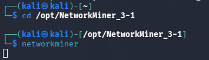

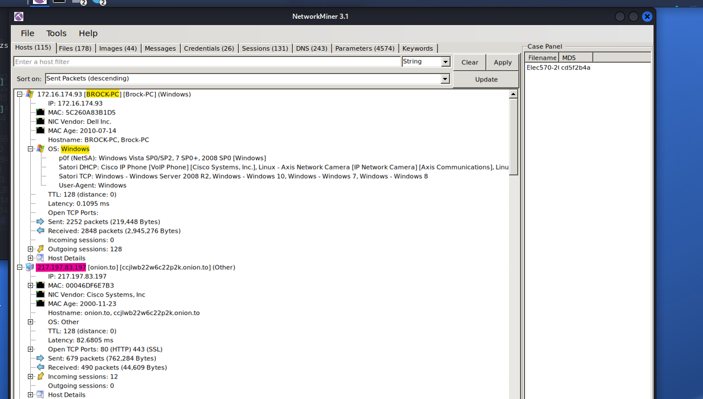

Una vez generadas las alertas, decidí utilizar otra herramienta: NetworkMiner, para visualizar nuestro pcap. file *(tráfico de red capturado)* de una forma más friendly. Filtrando los hosts por número de paquetes enviados *(# of sent packets)*. 

- Aqui identificamos nuestro primer host sospechoso 172.16.174.93 *(BROCK-PC)*, con un total de 2,252 paquetes enviados.
- El segundo host de interés es la IP externa 217.197.83.197, señalada por Suricata *(Priority 3)* por posibles actividades de malware en spam, asociada con Tor2Web, un proxy para acceder a sitios ocultos de Tor.

### Respuestas

- **IP Address of infected computer:** 172.16.174.93
- **HostName:** BROCK-PC
- **Mac Address:** 5C-26-0A-83-B1-D5
- **Operating System:** Windows Vista

---

## 2. ¿Cuál es el IP address y la URL del sitio web comprometido que visitó el usuario y que desencadenó el tráfico malicioso *(antes de que este se produjera)*?

Antes de pasar a Wireshark, decidí crear un pequeño resumen visual de todas las alertas generadas por Suricata, organizándose por prioridad y destacando las direcciones IP más relevantes. Esto facilita la identificación del tráfico sospechoso y permite seguir un proceso de análisis más estructurado en Wireshark.

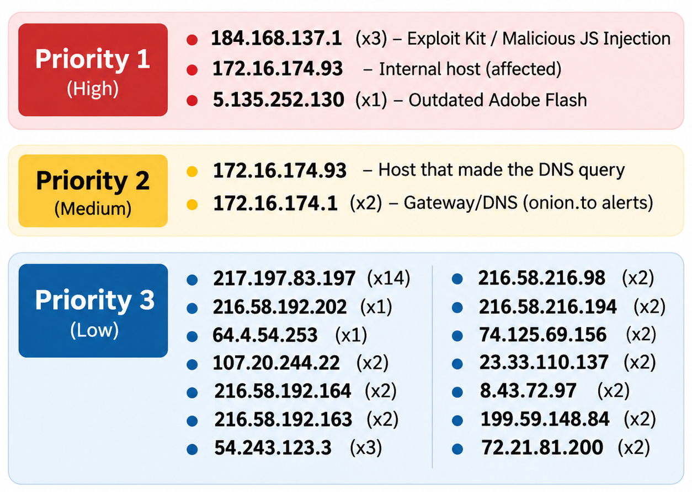

Procedemos a abrir el archivo PCAP en **Wireshark**, y aqui algunos de los mejores metodos/filtros para empezar con tu analisis:

- View **>** Time Display Format
- Statistics **>** Protocol Hierarchy **>** Hypertext Transfer Protocol **>** Apply as Filter **>** Selected
- Files **>** Export Objects **>** HTTP _(para hash calculations)_

También, podemos hacer lo siguientes:

- Añadir cualquier columna partir de nuestro **Packet Details Panel** _(panel de detalles del paquete)_.
- _(click on any column name)_ **>** Column Preferences **>** "Drag, add or move new columns"

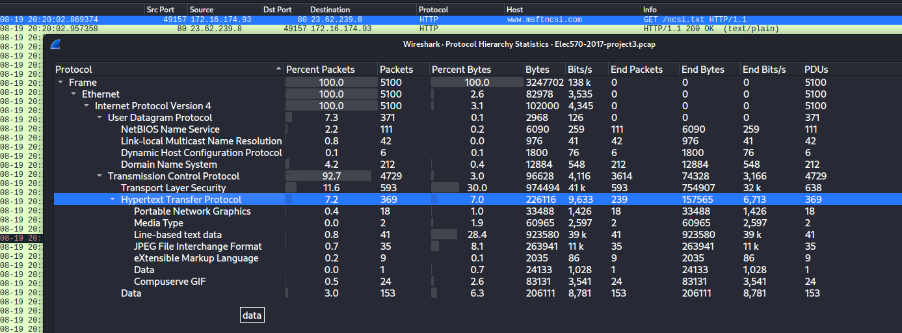

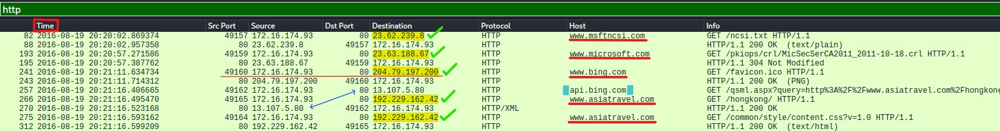

De acuerdo a lo de arriba, podemos decir que el usuario visitó **msftncsi.com, microsoft.com** y posteriormente **Bing**. También vemos una solicitud a **api.bing.com**, que está procesando una consulta relacionada con el sitio web **Asia Travel** a través del buscador Bing. 
- ¿Quizás el usuario estaba buscando destinos turísticos?
Luego, aparece un network packet HTTP/XML que contiene una respuesta de Bing con una sugerencia de búsqueda para **Asia Travel** *(Hong Kong)*. Esto podría estar relacionado con la función de autocompletado o sugerencias de búsqueda de Bing. Hasta aqui, nada raro.

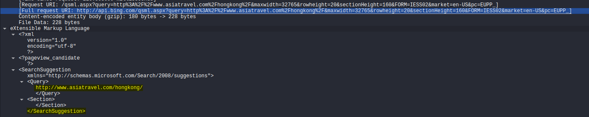

En la imagen de abajo, podemos ver algunos archivos **JavaScript** que están siendo enviados a **BROCK-PC.** Confío en que las alertas de Suricata son precisas, por lo que no pude encontrar esta dirección IP de **Asia Travel** entre las alertas generadas. Sin embargo, también exporté los objetos y comparé sus hashes para verificar su integridad.

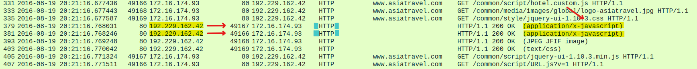

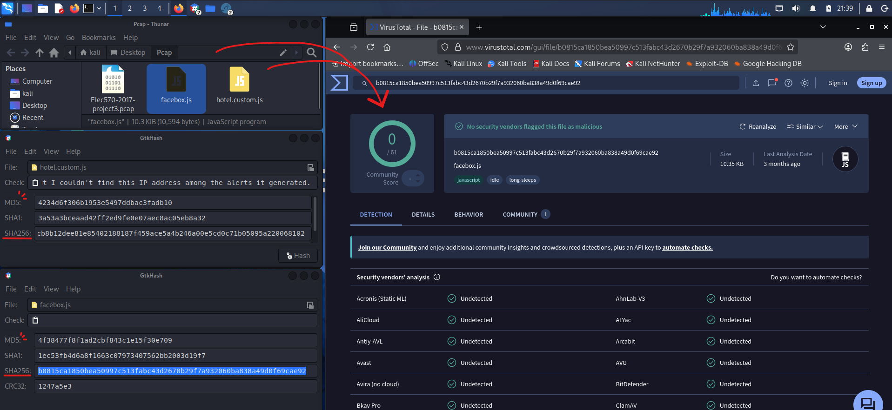

Hasta este punto, todo parece normal. Se observa tráfico relacionado con la carga de recursos del navegador, tal como aparecerían en la pantalla de **BROCK-PC**: animaciones, archivos **CSS**, scripts de **JavaScript** e imágenes de **AsiaTravel**. 

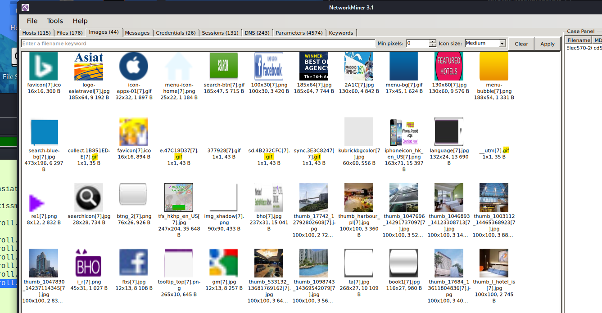

También noté que, al acceder a **AsiaTravel**, la página cargaba imágenes GIF durante la sesión de navegación de Brock. Además, **AsiaTravel** establecía conexiones con varios servidores de terceros. Esto sugiere que el sitio web cargaba recursos externos y utilizaba diferentes servicios de análisis, seguimiento y publicidad, como *Google Analytics, Kissmetrics* y *AdRoll*.

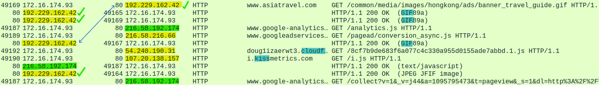

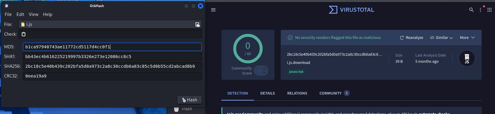

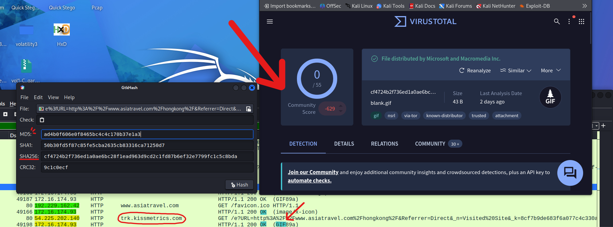

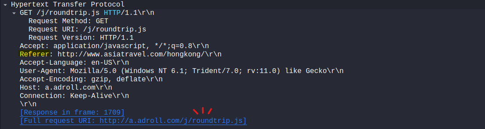

## El inicio de algo interesante

Según mi análisis, Brock estaba navegando por **Asia Travel**, un sitio web aparentemente seguro, cuando la página estableció una conexión con Kissmetrics, que respondió con una imagen GIF.

Inicialmente pensé que Brock podría haber hecho clic en ella debido a la actividad de ida y vuelta *(round-trip)*. Esto posteriormente lo llevó a A.AdRoll, que respondió con un archivo JavaScript. A partir de ese momento, la IP 54.243.123.3 comenzó a aparecer en las alertas de Suricata con prioridad 3.

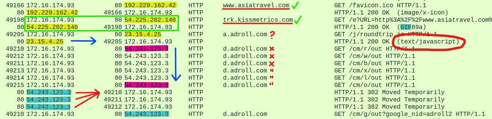

Revisé algunos de los archivos y, noté que el GIF recibido tenía una valoración negativa de la comunidad en VirusTotal_

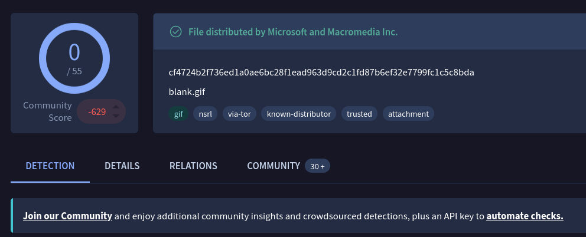

| Campo | Valor |
|-------|-------|
| **Network Packet #** | 1614 |
| **Objects** | GIF |
| **SRC** | 54.225.202.140 |
| **DST** | BROCK-PC |

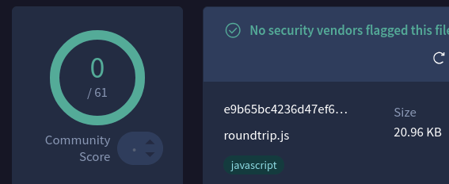

| Campo | Valor |
|-------|-------|
| **Network Packet #** | 1709 |
| **Objects** | GIF |
| **SRC** | 23.15.4.25 |
| **DST** | BROCK-PC |

Aunque el análisis de la comunidad de VirusTotal había señalado un GIF como potencialmente malicioso, esto no basta para concluir que sea malware, por lo que lo tomé solo como un indicador a investigar. Y justo apartir de aqui, vemos que **Brock** estableció una conexión con **hongkonghotels.org**, que resolvía a la dirección IP 184.168.137.1 en el network packet # 2221.

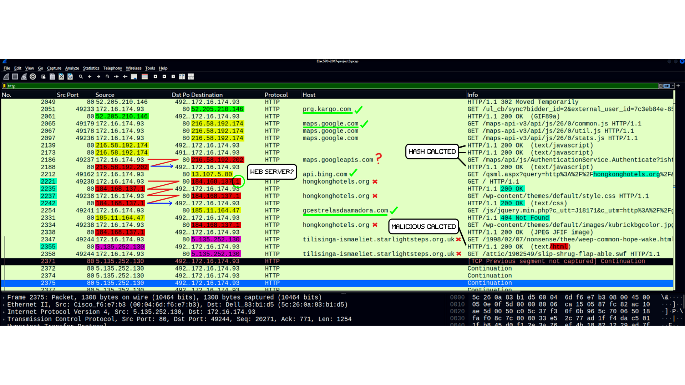

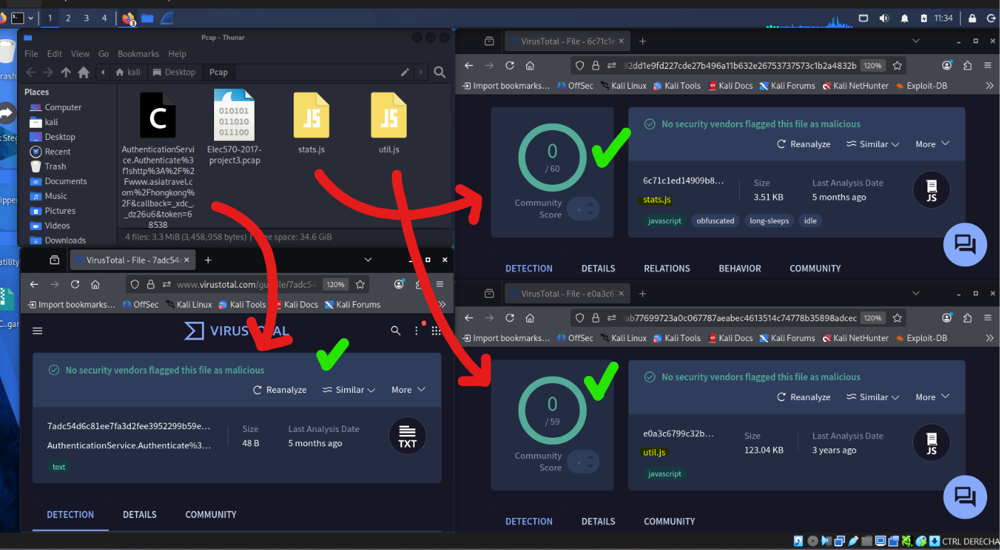

Al analizar los network packets del # 0 al 2173 con el filtro HTTP, no encontré tráfico claramente malicioso. La actividad parecía corresponder a una navegación normal, con solicitudes desde el equipo de **Brock** hacia diferentes servidores, relacionadas con búsquedas de alojamientos, destinos vacacionales, viajes por carretera y otra información turística. 

El cambio importante aparece en el network packet # 2221, donde **Brock** establece una conexión con **hongkonghotels.org**, que resuelve a la IP **184.168.137.1**. Esto tiene sentido con lo observado antes: Brock pudo haber estado buscando hoteles en Hong Kong a través de Google Maps y posiblemente hizo clic en la página web de algún hotel que lo llevó a este dominio. Esto explicaría por qué encontramos solicitudes a Google Maps API con información relacionada con **hongkonghotels.org**.

Además, las alertas de Suricata respaldan esta sospecha: primero identifican la IP de la API como potencialmente sospechosa con **Priority 3**, seguida de otra alerta relacionada con **hongkonghotels.org** con **Priority 1**, asociada a Exploit Kits (EKs) e inyección de JavaScript malicioso.

Por lo tanto, la actividad sospechosa comenzó después de la solicitud a Google Maps API y durante la navegación por el servidor web de **Hong Kong Hotels**, que sería el sitio comprometido visitado antes de que se produjera el tráfico malicioso.

### Answers

- **IP address** *(**before** malware traffic happened)*: 184.168.137.1
- **URL address** *(**before** malware traffic happened)*: hongkonghotels.org

---

## 3. ¿Cuál es la dirección IP y el nombre de dominio desde los que se distribuyó el malware?

Parece que el archivo malicioso se originó en el sitio web **tilisinga-ismaeliet.starlightsteps.org.** Después de que Brock visitará este sitio, el servidor entregó código HTML que contenía un objeto Flash incrustado, el cual hacía referencia a una versión desactualizada de Flash Player.

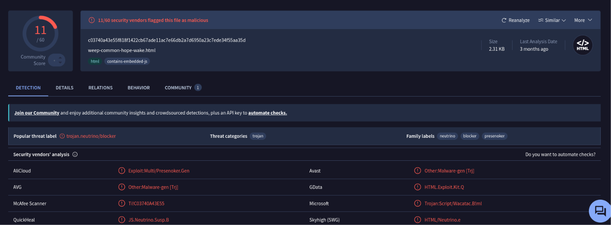

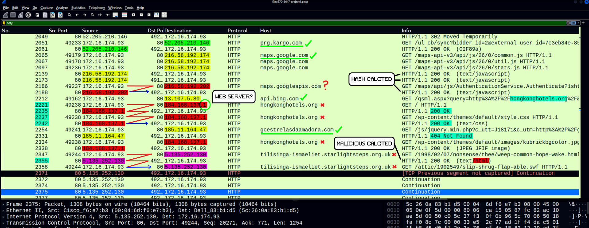

Algo interesante que se puede ver en el network packet # 2355 es que, al profundizar un poco más, aparece otra sección debajo del encabezado **Hypertext Transfer Protocol** llamada "Line-based text data", que contiene 37 líneas de código HTML...

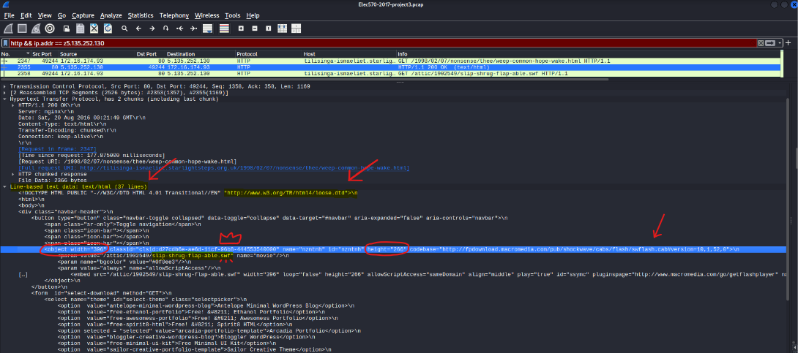

Una de las primeras líneas muestra **DOCTYPE HTML PUBLIC** y hace referencia a [www.w3.org](https://www.w3.org). Esto no indica malware, solo es el estándar web HTML 4.01 Transitional. 

El resto del código es más interesante: contiene un objeto Flash incrustado que hace referencia a un archivo externo **SWF** y le indica al navegador que lo cargue. Aquí empieza lo sospechoso. **VirusTotal** identificó el SWF como malicioso, lo que coincide con la alerta de Suricata *Outdated Adobe Flash – Priority 1*.

Este pudo ser el punto inicial de la infección en la computadora de Brock, y de ahí las conexiones posteriores a sitios como **hongkonghotels.org**, que también tiene alertas Priority 1 de **Exploit Kits (EKs)** e inyección de JavaScript malicioso.

### Answers

- **IP address** *(**delivered** malware)*: 5.135.252.130
- **DOMAIN name** *(**delivered** malware)*: [starlightstep.org.uk](http://starlightstep.org.uk)

---

## 4. Identifica el tipo de malware y chequea su payload

Este tipo de malware proveniente de **Starlightsteps.org** también parece estar clasificado como un Trojan *(troyano)*, según la información adicional obtenida durante su análisis en **VirusTotal**.

Además, el payload *(carga maliciosa)* del malware puede realizar diferentes acciones, como se refleja en sus técnicas de la website **MITRE ATTACK**. Entre ellas se encuentran el reconocimiento de servicios de red, la comunicación con servidores externos mediante protocolos de aplicación y el uso de canales cifrados para establecer comunicaciones de Comando y Control *(C2)*.

Varios proveedores de seguridad identificaron el archivo como malicioso, utilizando nombres de detección como *HTML.Exploit.Kit.Q*, *Trojan.Script.Wacatac.B!ml*, *JS.Neutrino.Susp.B* y *HTML/Neutrino.e*.

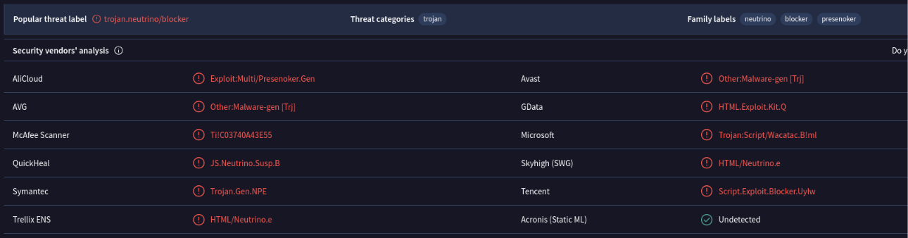

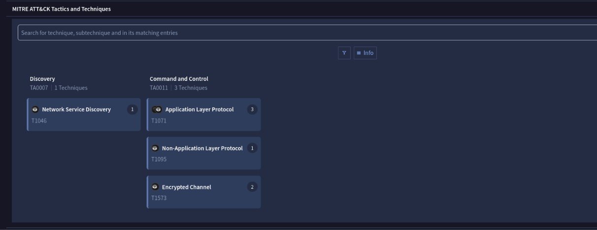

### Answers

- **Type of malware:** Troyan
- **Payload check:** Discover – TA0007 *(3)* y Command and Control – TA0011 *(3)*
- **DOMAIN name** *(**delivered** malware)*: [starlightstep.org.uk](http://starlightstep.org.uk)

---

## 5. Identifica y lista otros sitios maliciosos

Solo para mencionar, después de la infección inicial, la PC de Brock continuó comunicándose con el mismo sitio web malicioso. La **Info column** de Wireshark mostraba "Continuation", lo que indica que la transmisión de datos continuaba desde el mismo sitio web malicioso.

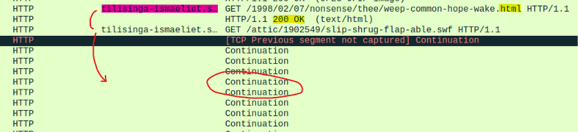

A partir de ese punto, comencé a listar otros posibles hosts maliciosos de cada paquete dentro del protocolo HTTP, pero no encontré nada más, así que decidí enfocarme en las alertas generadas por Suricata relacionadas con otros protocolos.

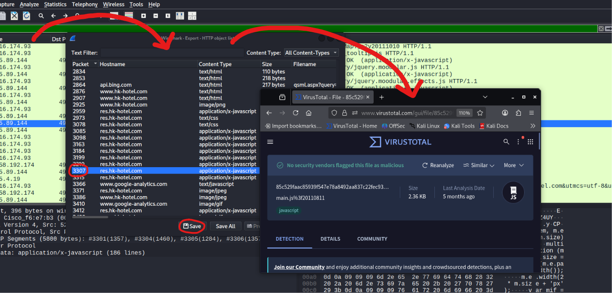

### Answers

| Campo | Valor |
|-------|-------|
| **Hostname/URL** | Hong Kong Hotels |
| **IP Address** | 184.168.137.1 |
| **Role** | Even though their .js seems to be okay, somehow it is still a EKs and JS Injection compromised website. |
| **Communication protocol or service** | HTTP, TCP |
| **Date and time of the interactions** | BROCK → WEBSITE *(20:21:36)* to END *(20:21:43)* in 2016 |

| Campo | Valor |
|-------|-------|
| **Hostname/URL** | Starlight Steps Org UK |
| **IP Address** | 5.135.252.130 |
| **Role** | Delivered the malware in html markup language |
| **Communication protocol or service** | HTTP, TCP |
| **Date and time of the interactions** | WEBSITE → BROCK *(20:21:37)* to END *(20:22:49)* in 2016 |

| Campo | Valor |
|-------|-------|
| **Hostname/URL** | BROK'S GATEWAY ROUTER |
| **IP Address** | 172.16.174.1 |
| **Role** | Brock's default gateway, responsible for access to internet, traffic related to [onion.to](http://onion.to), a Tor proxy service used to anonymize and encrypt internet traffic |
| **Communication protocol or service** | DNS |
| **Date and time of the interactions** | ROUTER → BROCK PC *(20:22:35)* in 2016 |

| Campo | Valor |
|-------|-------|
| **Hostname/URL** | ONION.TO |
| **IP Address** | 217.197.83.197 |
| **Role** | The external server 217.197.83.197 communicated with Brock's infected PC. An HTTP object associated with an .onion.to hostname was identified, potentially indicating an attempt to access a Tor-related service. |
| **Communication protocol or service** | TCP, HTTP and TLSv1.2 |
| **Date and time of the interactions** | PROXY SERVICE → BROCK PC *(20:22:35)* to END *(20:22:52)* in 2016 |

 

Al parecer, inicialmente pasé por alto dos hosts relacionados con actividad de **ransomware**:

- **85.14.243.9:** *Ransomware Callback Server*, usado por el malware para comunicarse con sus operadores.
- **217.197.83.197:** *Ransomware Payment Server*, alojado en la red Tor (`.onion`), que permite a los atacantes mantener la página de pago del rescate de forma anónima y dificulta ubicarlos.

---

## 6. Graphic sketch and explain of the attack scenario

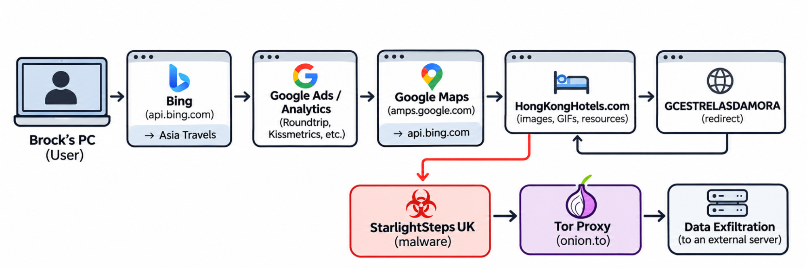

Mi teoría de attack scenario analysis es que **Brock**, durante sus horas de trabajo, decidió buscar destinos turísticos en China utilizando Bing, lo que generó solicitudes a api.bing.com y lo llevó al sitio web **Asia Travels.**

Luego, **Google Ads/Analytics** generó solicitudes relacionadas con Roundtrip, Kissmetrics y otros servicios. También visitó otros sitios web, como Kargo.com. Después, parece haber accedido a Google Maps, donde posiblemente encontró algún anuncio, ya que el tráfico muestra solicitudes a **maps.googleapis.com**, que lo llevaron a una dirección de api.bing.com y posteriormente a **HongKongHotels.org**, donde se cargaron diferentes recursos de la página, incluyendo imágenes y GIFs.

Sin embargo, las cosas se volvieron más interesantes después, cuando Brock visitó otro sitio web que aparentemente parecía legítimo, pero no pudo cargarse y mostró un error 404 Not Found, bajo el nombre de **GCESTRELASDAMORA**. Desde allí, fue redirigido nuevamente a HongKongHotels.org. Este comportamiento resulta inusual porque, poco después, Brock accedió al sitio web malicioso responsable de entregar el malware: **StarlightSteps UK**.

No estoy completamente seguro de cómo llegó hasta allí, pero una posibilidad es que haya hecho clic en un anuncio emergente *(pop-up advertisement)* mientras navegaba por HongKongHotels.com. Según el análisis, el sitio comprometido habría redirigido a Brock hacia una página de destino de un ransomware *(Ransomware Landing Page)*, donde se produjo la infección mediante la descarga del archivo malicioso.

Después de la infección, el equipo estableció una conexión con el **Ransomware Callback Server** *(85.14.243.9)*, utilizado para comunicarse con los operadores del ransomware. Posteriormente, se establecieron conexiones con el Ransomware Payment Server *(217.197.83.197)*, alojado en la red Tor mediante un servicio .onion, posiblemente utilizado para gestionar el pago del rescate de forma anónima.

Finalmente, el tráfico también muestra comunicaciones a través de un proxy Tor *(onion.to)*, lo que podría estar relacionado con las comunicaciones cifradas del malware y la posible exfiltración de información.

---

## 7. Medidas de mitigación y posibles soluciones de remediación

En primer lugar, una de las medidas de seguridad más importantes es asegurarse de que los empleados eviten acceder a sitios web desde dispositivos conectados a la red de la empresa, especialmente cuando estos tienen acceso a información confidencial. También se debe educar a los empleados sobre la importancia de comprobar si los sitios web utilizan HTTPS en lugar de HTTP. Por supuesto, los sitios web maliciosos también pueden tener certificados HTTPS válidos, pero sigue siendo una buena práctica de seguridad.

En segundo lugar, implementar firewalls dentro de la infraestructura de red distribuida de la empresa podría ayudar a bloquear conexiones sospechosas. Además, implementar una solución de seguridad activa, como Suricata o Snort, permitiría detectar tráfico sospechoso, generar alertas y bloquear conexiones maliciosas.

Otra posible solución sería proteger el acceso remoto de Brock a la red de la empresa. Esto podría lograrse mediante una arquitectura que incluya dos firewalls, una DMZ y un gateway VPN para autenticar a los usuarios antes de permitirles acceder a los recursos internos.

La autenticación multifactor *(MFA)* también podría proporcionar una capa adicional de seguridad. Estas son algunas de las soluciones que se me ocurren hasta el momento.
